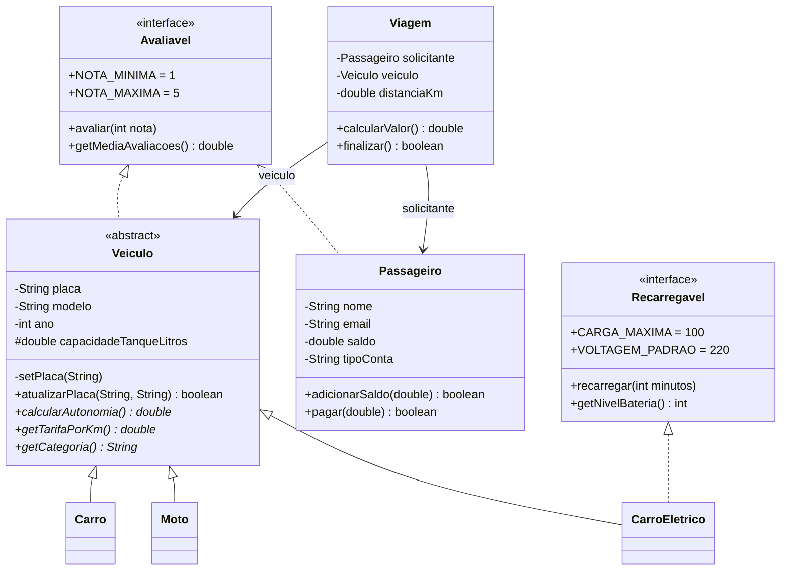

# Projeto FiapRide - [Seu Nome Completo]

## 📊 Informações do Aluno

- **Nome:** [Seu Nome Completo]
- **RM:** [Seu RM]
- **Turma:** [Sua Turma]
- **Curso:** [Seu Curso]
- **GitHub:** [@nicolasaraujo04](https://github.com/nicolasaraujo04)

---

## 🎯 Descrição do Projeto

Este projeto é o resultado do aprendizado nas aulas 1-9 de Programação Orientada a Objetos, onde desenvolvemos o sistema **FiapRide**, um app de mobilidade urbana. Ele cadastra passageiros com saldo em conta, uma frota de veículos (carros, motos e carros elétricos) e viagens que ligam um passageiro a um veículo, calculando o valor da corrida e debitando o saldo ao final. Cada aula adicionou um conceito novo ao mesmo código, e o histórico de commits mostra essa evolução passo a passo.

Além do FiapRide, o repositório traz um **projeto pessoal**: um sistema de empréstimos de biblioteca que aplica os mesmos conceitos em outro domínio.

### Como executar

**No Eclipse:** abra o projeto (File > Import > Existing Projects into Workspace), clique com o botão direito em `Main.java` ou `BibliotecaApp.java` e escolha *Run As > Java Application*.

**Pelo terminal:**

```bash
# compilar tudo
javac -d out $(find src -name "*.java")

# FiapRide
java --module-path out -m FiapRideNicolas/br.com.fiapride.Main

# Projeto pessoal (Biblioteca)
java --module-path out -m FiapRideNicolas/br.com.biblioteca.BibliotecaApp
```

### Estrutura

```
src/
├── module-info.java             (módulo FiapRideNicolas)
br/com/
├── fiapride/
│   ├── Main.java
│   └── model/
│       ├── Passageiro.java      (aulas 1-4, 9)
│       ├── Veiculo.java         (aulas 4, 6-9) - abstrata
│       ├── Viagem.java          (aula 5)
│       ├── Carro.java           (aulas 6-8)
│       ├── Moto.java            (aulas 6-8)
│       ├── CarroEletrico.java   (aula 9)
│       ├── Avaliavel.java       (aula 9) - interface
│       └── Recarregavel.java    (aula 9) - interface
└── biblioteca/                  (projeto pessoal)
    ├── BibliotecaApp.java
    └── model/
        ├── ItemAcervo.java, Livro.java, Revista.java
        ├── Usuario.java, Emprestimo.java
        └── Emprestavel.java
```

### Diagrama de classes - FiapRide



---

## ✅ Checklist de Implementação

- [x] Aula 1 - Classes e Objetos
- [x] Aula 2 - Métodos
- [x] Aula 3 - Encapsulamento
- [x] Aula 4 - Construtores
- [x] Aula 5 - Associação
- [x] Aula 6 - Herança
- [x] Aula 7 - Polimorfismo
- [x] Aula 8 - Classes Abstratas
- [x] Aula 9 - Interfaces

---

## 🤔 Perguntas de Reflexão

### Aula 1 - Classes e Objetos

**Pergunta:** Por que precisamos criar uma classe `Passageiro`? Não seria mais fácil apenas criar variáveis soltas no main, como `String nomeAna = "Ana"` e `double saldoAna = 50.0`?

**Pense:** E se o FiapRide tiver 1 milhão de usuários? Como a Classe ajuda a resolver isso?

**Sua Resposta:**
Com variáveis soltas, cada passageiro novo exige escrever novas variáveis à mão (`nomeBruno`, `saldoBruno`, `emailBruno`...). Com 1 milhão de usuários isso é impossível: o código teria milhões de linhas e nada garantiria que todo passageiro tem os mesmos dados. A classe resolve isso funcionando como um molde: eu descrevo uma única vez o que é um passageiro (nome, e-mail, saldo, tipo de conta) e depois crio quantos objetos quiser com `new Passageiro()`, inclusive dentro de um loop ou lendo de um banco de dados. Além disso, os dados de uma pessoa ficam juntos em um único objeto, então não tem como misturar o saldo da Ana com o nome do Bruno. Também posso passar o passageiro inteiro para outras partes do sistema (como a `Viagem`) e guardar todos em uma lista. No começo achei que a classe era só "mais código", mas percebi que ela é o que permite o sistema crescer.

---

### Aula 2 - Métodos

**Pergunta:** Se nós podemos simplesmente fazer `passageiro.saldo = passageiro.saldo + 100` diretamente no código principal, por que dá tanto trabalho criar um método específico chamado `adicionarSaldo(valor)` para fazer isso? Quais seriam os riscos para a nossa startup de mobilidade se deixássemos qualquer programador alterar o saldo diretamente?

**Sua Resposta:**
O método concentra a regra de negócio em um único lugar. No meu `adicionarSaldo`, um valor zerado ou negativo é recusado; no `pagar`, a corrida só é debitada se houver saldo suficiente. Se cada programador mexesse no saldo diretamente, cada um teria que lembrar dessas regras, e bastaria um esquecer para aparecer saldo negativo, recarga de -100 (que na prática é um débito escondido) ou corridas pagas sem dinheiro. Para uma startup de mobilidade isso significa prejuízo financeiro, fraude e perda de confiança dos usuários. Com o método, se a regra mudar (por exemplo, bônus de 5% em recargas acima de R$ 100), eu altero um único lugar e o sistema inteiro passa a obedecer. O método também deixa o código mais legível: `ana.adicionarSaldo(30)` explica a intenção muito melhor que uma conta solta.

---

### Aula 3 - Encapsulamento

**Pergunta:** No nosso código, os atributos são `private`, mas os métodos `getSaldo()` e `getNome()` são `public`. Por que é seguro deixar o `get` público, mas perigoso deixar o atributo original público?

**Sua Resposta:**
O getter entrega uma cópia do valor, como uma cópia de um documento: a pessoa pode ler, mas, se rabiscar a cópia, o original continua intacto. Quando chamo `getSaldo()`, recebo um `double` que posso usar à vontade sem alterar o saldo real do passageiro. Já um atributo público é entregar o documento original: qualquer parte do código pode fazer `ana.saldo = 1000000` e ninguém fica sabendo nem consegue impedir. Com o atributo `private`, a única forma de mudar o estado é passando pelos métodos que eu controlo, com validação. Por isso, no meu `Passageiro`, eu nem criei `setSaldo()`: o saldo só muda via `adicionarSaldo()` e `pagar()`. E os setters que existem validam os dados, como o `setEmail()`, que recusa e-mails sem `@`. O encapsulamento me mostrou que proteger o dado é tão importante quanto armazená-lo.

---

### Aula 4 - Construtores

**Pergunta:** Na nossa classe `Veiculo`, nós tomamos duas decisões arquitetônicas muito importantes: 1. Nós **não** criamos o método `setModelo()`. 2. O `setPlaca()` foi criado como **privado**, e criamos um método público chamado `atualizarPlaca()` para acessá-lo. Pensando no mundo real e no Clean Code: Por que é um erro gravíssimo clicar em 'Gerar Getters e Setters para tudo' automaticamente na sua IDE? Como as nossas duas decisões acima protegem o sistema de fraudes e falhas de lógica?

**Sua Resposta:**
Gerar setters para tudo cria uma porta de alteração para cada atributo, inclusive para dados que no mundo real não mudam. Um Onix não vira uma Ferrari; o modelo é definido na fabricação. Por isso o modelo é recebido apenas no construtor e não tem `setModelo()`: se existisse, um motorista poderia cadastrar um carro popular e depois "transformá-lo" em categoria premium para cobrar mais caro, ou o veículo da viagem não bateria com o carro que o passageiro viu na rua. A placa pode mudar, mas não é só "alterar um campo no banco": é um processo real no Detran. Por isso o `setPlaca()` é privado (usado só para validar o formato no construtor) e o público é o `atualizarPlaca(novaPlaca, protocoloDetran)`, que exige um protocolo válido e registra a troca. Assim, o código representa o processo de negócio, não só o dado. A lição é que cada setter deve ser uma decisão consciente, e não algo gerado automaticamente.

---

### Aula 5 - Associação

**Pergunta:** No construtor da `Viagem`, nós exigimos o objeto inteiro (`Passageiro solicitante`). Se o nosso resumo só precisa imprimir o nome da pessoa, não seria mais fácil e mais leve pedir apenas a String do nome no construtor da Viagem (`String nomeDoPassageiro`) em vez do objeto todo?

_Pense nas regras de negócio: O que acontece na hora que a Viagem acaba e o sistema precisa descontar o saldo? Se a Viagem tiver apenas a String "Ana Silva", ela consegue mexer no dinheiro dela?_

**Sua Resposta:**
Com apenas a String "Ana Silva", a viagem saberia o nome, mas não teria como agir sobre a Ana. Na hora de finalizar, o meu método `finalizar()` chama `solicitante.pagar(calcularValor())`; isso só funciona porque a viagem guarda uma referência para o objeto real. Também uso o tipo de conta do passageiro para dar desconto PREMIUM, coisa que um nome não informa. E nomes não são únicos: pode haver várias "Ana Silva" no app. Sobre ser "mais leve": em Java, guardar o objeto não copia a pessoa inteira, só guarda uma referência (um "endereço") para o mesmo objeto, então o custo é praticamente igual. Testei no `main` que `v1.getSolicitante() == ana` é `true` e que o saldo da Ana diminui depois da viagem. A associação TEM-UM permite que os objetos colaborem, e não apenas troquem textos.

---

### Aula 6 - Herança

**Pergunta:** No nosso código, a mãe `Veiculo` possui os atributos `placa` e `modelo` como `private`. Quando o `Carro` herda de `Veiculo`, ele recebe esses atributos, mas o código dentro de `Carro` NÃO consegue fazer `this.placa = "ABC"`. Ele é obrigado a usar o `super()` ou o `setPlaca()`. Por que o Java não deixa a filha alterar as variáveis privadas da mãe diretamente? Qual o princípio das aulas passadas que isso está protegendo?

**Sua Resposta:**
Isso protege o **encapsulamento** (aula 3). A classe `Veiculo` tem regras para seus próprios dados, como a validação do formato da placa Mercosul e a exigência de protocolo do Detran para trocá-la. Se as filhas pudessem escrever direto em `placa`, qualquer `Carro` ou `Moto` poderia burlar essas regras, e a validação da mãe deixaria de valer. Ao obrigar o uso de `super(...)`, a mãe continua sendo a única responsável por inicializar e validar o que é dela, e todas as filhas herdam essas regras de graça; no meu teste, uma `Moto` com placa "XX" foi bloqueada pela validação da `Veiculo`. Herança significa reaproveitar comportamento, não ganhar acesso irrestrito. Quando eu quis que as filhas usassem um dado da mãe nos cálculos, criei `capacidadeTanqueLitros` como `protected`: um acesso intencional e limitado à hierarquia, diferente de deixar tudo aberto.

---

### Aula 7 - Polimorfismo

**Pergunta:** No nosso loop `for (Veiculo veiculo : frota)`, a variável `veiculo` é do tipo genérico `Veiculo`. Se esquecêssemos de criar o método `calcularAutonomia()` lá na classe mãe `Veiculo`, nós conseguiríamos chamá-lo dentro do loop, mesmo sabendo que ele existe dentro do `Carro` e da `Moto`? Por que o contrato precisa existir na base da hierarquia?

**Sua Resposta:**
Não conseguiríamos; o código nem compilaria. O compilador decide o que pode ser chamado olhando o tipo declarado da variável, que é `Veiculo`, e não o objeto que estará ali durante a execução. Se `Veiculo` não declara `calcularAutonomia()`, para o compilador esse método não existe, mesmo que todas as filhas o tenham. A alternativa seria testar com `instanceof` e fazer cast para cada tipo, o que traz de volta os `if/else` que o polimorfismo quer eliminar e quebraria toda vez que um novo tipo de veículo fosse criado. Com o método declarado na mãe, o contrato fica garantido ("todo veículo sabe calcular sua autonomia") e, em tempo de execução, o Java chama a versão sobrescrita certa de cada objeto. Foi assim que adicionei o `CarroEletrico` na aula 9 sem mudar uma linha do loop. O mesmo vale para `getTarifaPorKm()`: a `Viagem` cobra diferente por carro ou moto sem saber qual dos dois recebeu.

---

### Aula 8 - Classes Abstratas

**Pergunta:** Pense no mundo real: Faz sentido existir um objeto que é APENAS 'Veículo' sem ser um tipo específico? Você já entrou em uma concessionária e comprou "um veículo" genérico, sem ser carro, moto, caminhão ou nada disso? Por que, então, no código, precisamos EXPLICITAMENTE dizer ao Java que `Veiculo` é `abstract`? Por que ele não deduz isso sozinho? Pense: Se esquecermos de colocar `abstract`, qual o risco que corremos? Alguém pode criar `new Veiculo()` e quebrar a lógica do nosso sistema?

**Sua Resposta:**
Não faz sentido: "veículo" é uma categoria, não algo que existe sozinho. O Java não deduz isso porque, para ele, uma classe é só código; quem sabe que "veículo genérico" não existe no negócio é o programador. Uma classe concreta com construtor público pode perfeitamente ser instanciada, então a intenção precisa ser declarada. Antes do `abstract` (na aula 7), meu `Veiculo` tinha um `calcularAutonomia()` que retornava 0. Se alguém fizesse `new Veiculo(...)` e colocasse na frota, o app mostraria autonomia de 0 km e cobraria uma tarifa "padrão" que não corresponde a veículo nenhum, um erro silencioso e difícil de achar. Com `abstract`, `new Veiculo()` vira erro de compilação (testei: "Veiculo is abstract; cannot be instantiated") e os métodos abstratos obrigam toda filha a implementar `calcularAutonomia()`, `getTarifaPorKm()` e `getCategoria()`. O erro passa da execução para a compilação, que é o lugar mais barato para encontrá-lo.

---

### Aula 9 - Interfaces

**Pergunta:** Por que Java permite herança simples (apenas uma mãe), mas múltipla implementação de interfaces (vários contratos)? Pense: Se `CarroEletrico` pudesse herdar de `Veiculo` E de `Bateria` ao mesmo tempo (herança múltipla), o que aconteceria se AMBAS as mães tivessem um método chamado `ligar()`? Como as interfaces resolvem esse problema?

**Sua Resposta:**
Se `CarroEletrico` herdasse de duas classes que implementam `ligar()` de jeitos diferentes, o Java não saberia qual código executar ao chamar `carroEletrico.ligar()`; também ficaria ambíguo qual atributo (estado) de cada mãe usar. É o famoso "problema do diamante". O Java evita isso permitindo uma única classe mãe, que é de onde vem a implementação e o estado. Interfaces, por outro lado, são contratos: elas dizem O QUE a classe precisa saber fazer, não COMO. Se duas interfaces exigirem `ligar()`, não há conflito, porque existe só uma implementação: a que a própria classe escreve. Por isso meu `CarroEletrico` estende `Veiculo` (o que ele É) e implementa `Recarregavel` (uma capacidade que ele TEM), além de herdar `Avaliavel`. As constantes das interfaces (`CARGA_MAXIMA`, `NOTA_MAXIMA`) são `public static final`, então também não guardam estado que possa conflitar. E a interface ainda une classes de hierarquias diferentes: `Passageiro` e `Veiculo` não têm nada em comum, mas ambos são `Avaliavel` e ficam na mesma lista de avaliações.

---

## 🚀 Desafios Técnicos Implementados

### Desafio Pessoal (Seu Projeto)

**Qual foi o domínio que você escolheu para seu projeto pessoal?**
Sistema de Biblioteca: controle de acervo e empréstimos com prazo de devolução e multa por atraso (pacote `br.com.biblioteca`).

**Quais classes você criou?**
- `ItemAcervo` (classe abstrata, mãe de todos os itens)
- `Livro` e `Revista` (filhas, com prazos diferentes)
- `Emprestavel` (interface com a constante `MULTA_POR_DIA`)
- `Usuario` (leitor, com limite de empréstimos e multa pendente)
- `Emprestimo` (associa um `Usuario` a um `ItemAcervo`)
- `BibliotecaApp` (classe principal com os testes)

**Qual foi o maior desafio técnico que você enfrentou?**
O maior desafio foi manter o estado consistente entre três objetos ao mesmo tempo. Um empréstimo precisa marcar o item como indisponível, aumentar o número de empréstimos do usuário e calcular a data de devolução; na devolução, o caminho inverso, mais a multa. Na primeira versão eu fazia essas atualizações no `main`, e era fácil esquecer uma delas, deixando um livro "emprestado" para sempre ou um usuário com contador errado.
A solução foi aplicar o que aprendi nas aulas 2, 3 e 5: concentrei essa lógica no construtor do `Emprestimo` e no método `devolver()`, que são os únicos pontos que alteram os outros objetos. Os métodos `registrarEmprestimo()` e `registrarDevolucao()` do `Usuario` ficaram sem `public` (visibilidade de pacote), então o `main` não consegue chamá-los diretamente; só o `Emprestimo` consegue.
Outro ponto foi o prazo: livros grandes têm 21 dias, livros comuns 14 e revistas 7. Em vez de um `if` por tipo dentro do `Emprestimo`, usei polimorfismo: cada classe implementa `getPrazoEmDias()` e o `Emprestimo` apenas chama o método. Para calcular a multa usei `LocalDate` e `ChronoUnit.DAYS.between`, que eu ainda não conhecia. Por fim, tratei as regras inválidas com exceções (`IllegalStateException` quando o livro já está emprestado ou o usuário tem multa), o que deixou os testes do `main` bem mais claros.

---

## 🎓 Conclusão

**O que você aprendeu nestas 9 aulas?**
Aprendi que orientação a objetos é uma forma de modelar o mundo real em código, não só uma sintaxe nova. Comecei com uma classe que era basicamente um "pacote de variáveis" e, a cada aula, ela ganhou responsabilidade: métodos com regras, atributos protegidos, construtores que garantem objetos válidos desde o nascimento, objetos que colaboram entre si e hierarquias que permitem adicionar um tipo novo (o `CarroEletrico`) sem alterar o código que já funcionava. A maior mudança de mentalidade foi passar a pensar "quem é responsável por este dado e quem pode alterá-lo?" antes de escrever o código.

**Qual conceito foi mais difícil de entender?**
[Revise com a sua experiência real. Sugestão:] Polimorfismo. No começo eu não entendia por que `veiculo.calcularAutonomia()` dava erro de compilação quando o método não estava na mãe, se o objeto dentro da variável era um `Carro`. Superei ao separar duas coisas: o tipo da variável (o que o compilador deixa chamar) e o tipo do objeto (qual versão o Java executa). Escrever o loop da frota e ver cada veículo imprimir uma autonomia diferente fez o conceito "clicar".

**O que você melhoraria no seu projeto se pudesse refazer?**
- No `CarroEletrico`, reaproveitei o atributo `capacidadeTanqueLitros` da mãe para guardar a bateria em kWh. Funciona, mas o nome fica enganoso; eu moveria a capacidade de energia para as filhas ou criaria uma interface `Abastecivel` para os veículos a combustão.
- Usaria `enum` para `tipoConta` e para o status da `Viagem`, no lugar de `String`, para que erros de digitação fossem pegos pelo compilador.
- Usaria `BigDecimal` para dinheiro, já que `double` pode gerar erros de arredondamento.
- Adicionaria um `Motorista` associado ao `Veiculo` e testes automatizados com JUnit, em vez de testar só pelo `main`.
